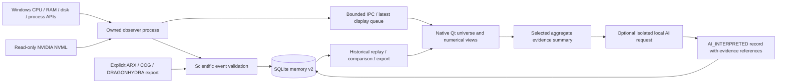

# ATOMVERSE AI architecture — 0.2.0-alpha.2

Mission 002A packages one computational foundation in three formats. Windows EXE and wheel use the existing PySide6 application. Android uses a native Java Canvas/Activity interface and a Chaquopy ARM64 Python runtime. Gradle copies `core.py`, `science.py`, `storage.py`, `mobile.py` and the version module from the authoritative package; no parallel event/science/database implementation is maintained.

`mobile.py` adapts public Android observations, preserves schemas 1.0/1.1 and SQLite v2, and emits bounded rendering packets with classification colors and deterministic visual scores. One foreground executor owns Python/SQLite; a scheduled job samples only after explicit opt-in. Activity pause cancels sampling; destruction drains the worker and closes memory. Rendering is capped at 256 objects and 10–30 fps. Android's system document picker supplies explicit JSON sources. Imports are prevalidated, immutable and protected from rolling retention. Mobile history can include multiple scientific classes, each labeled; live sampling emits no simulations.

Android app CPU utilization is `min(100, 100 * delta_app_cpu_ms / delta_elapsed_ms / reported_logical_processors)`, labeled DERIVED with recorded inputs. RAM/storage used percent is `100 * (total - available) / total`. GPU load, VRAM, device-wide CPU and other unsupported sensors are unavailable. Android does not load Windows APIs, run CUDA benchmarks, inventory other processes or require an AI service. The desktop retains its broader verified capabilities. See INSTALLATION.md for the matrix and EVIDENCE/MISSION-002A-FINAL-VERIFICATION.json for measured package results.

Mission 002 extends the verified Python / PySide6 / SQLite application. Mission 001 documents are preserved in `RELEASES/0.1.0-alpha.1`; its tests, private database, evidence and artifacts remain intact.

`core.py` preserves schema 1.0 and immutable bodies. `science.py` adds schema 1.1 classification, per-metric formulas, entity identity, relationships, unavailable reasons and retention policy. JSON exports retain full provenance; CSV includes classifications and scientific metadata.

`observer.py` samples cumulative CPU user/system/idle counters, cores, reported frequency, physical and committed memory, aggregate disk counters, system-volume capacity and bounded process metadata. One Toolhelp snapshot supplies parent PIDs; creation times reject impossible reused-parent relationships. Process identity combines PID and creation time. A missing bounded sample is not a termination. Exact termination time is not claimed.

`nvml.py` reads available utilization, memory, temperature, power and clocks without creating a CUDA context. Compute/graphics process context membership may be linked to a verified process identity. It does not supply per-process utilization or reliable WDDM VRAM attribution. Device-wide GPU activity is never classified as AI activity.

`observer_worker.py` owns collection and batched persistence, committing before each emitted batch. `live_controller.py` validates IPC, caps its byte buffer at 4 MiB and display queue at four batches, and stops unresponsive workers. Dropped display batches remain committed. Sampling is 0.5–30 seconds with no catch-up busy loop. Observation starts off. Closing the GUI stops owned observation, interpretation and benchmark workers.

`LivingWindow` extends the original `Window`. Live caches hold at most 1,500 events, tables 1,000 rows, tracked process identities 256 and rendered particles 512. Explicit historical loading is bounded by the 10,000-row store. Orbit paths are cached; frame caps and adaptive particle limits reduce work.

`storage.py` backs up v1 and migrates additively. Legacy records, benchmarks, interpretations and source evidence referenced by interpretations/comparisons are protected. Only rolling continuous observations are eligible for configured retention. A bounded audit records removals. Protected-history exhaustion raises an error rather than deleting evidence.

`intelligence.py` sends at most 12 aggregate hardware events and a bounded question to loopback. Process names, paths and inventory text are excluded. Native Ollama requests specify CPU execution, four threads, 4,096 context tokens, 96 generated tokens and unload after use. The GUI enforces 90 seconds. Compatible local endpoints control their own hardware policy. AI records contain no numerical measurements and cannot execute actions.

Optional export adapters do not require sibling applications to run. No authentication store, model file or unrelated repository is changed. Autonomous repair, causal diagnosis, comprehensive process dependencies and unrestricted monitoring are outside this release.
