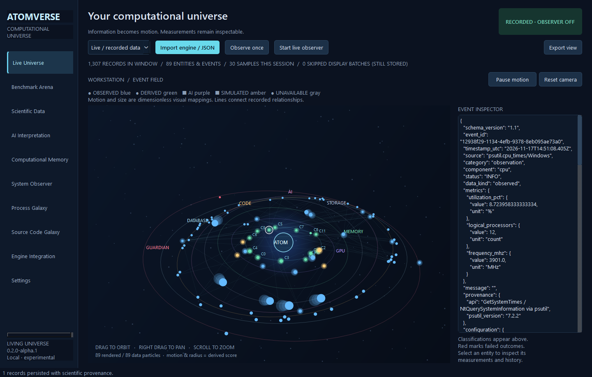

# ⚛️♾️ ATOMVERSE AI
## THE LIVING UNIVERSE OF COMPUTATIONAL INTELLIGENCE

**0.2.0-alpha.1 — The Living Universe.** An experimental native Windows application that turns selected, real computational observations into inspectable visual structures and persistent history. Mission 002 continues the verified Mission 001 foundation.

ATOMVERSE AI is a living computational universe that transforms real hardware telemetry, AI activity, source code, benchmarks and software events into interactive visual structures, measurable simulations and persistent knowledge.

**The computer's actual computational behavior determines the behavior of its graphical universe.**

Information absorption is inspired by atoms absorbing energy. This is a digital analogy: no physical atoms are manipulated and no physical energy is produced from information. Visual energy is a dimensionless, reproducible score.

> INFORMATION BECOMES MOTION.  
> COMPUTATION BECOMES STRUCTURE.  
> MEASUREMENTS BECOME A UNIVERSE.

### Mission contract

1. Publish this public documentation repository and verify its contents remotely.
2. Only after that verification, discover the workstation and reusable engines, select an architecture, and implement a tested Windows application.

The original human concept, engineering proposals, implemented capabilities, and future experiments are separate. A file describing a capability is not evidence that it exists.

### Explore the mission

- [Original human vision](CONCEPT/ORIGINAL-HUMAN-VISION.md)
- [Genesis architecture](GENESIS-ARCHITECTURE.md)
- [Roadmap](ROADMAP.md)
- [Acceptance criteria](SPECIFICATIONS/ACCEPTANCE-CRITERIA.md)
- [Security boundaries](ARCHITECTURE/SECURITY-BOUNDARIES.md)
- [Engineering decisions](ARCHITECTURE/ENGINEERING-DECISIONS.md)
- [License decision](LICENSE-DECISION.md)

### First usable milestone

Launch on Windows; ingest a real ARX report; validate and normalize events; create inspectable graphical objects; persist SQLite history; execute bounded CPU and supported GPU benchmarks; replay events; export JSON; report failures accurately; close cleanly. The interface should work without command-line knowledge.

**REAL DATA → EVENT → VISUAL OBJECT → MEASUREMENT → MEMORY**

Target: Windows 11 x64, PowerShell 7. Hardware and installed software must be freshly discovered. Historical hardware reports are not proof of present capabilities.

### Working now

- Interactive projected universe: rotate, pan, zoom, select, pause and adjust rendering quality.
- Explicit ARX 0.1 report import with schema checks, stable event IDs, units, hashes and field provenance.
- Opt-in continuous CPU/core, RAM/commit, disk and NVIDIA observation in an isolated worker, with configurable sampling and retention.
- Process entities identified by PID and creation time, verified parent relationships, resource use, hashed executable identity and supported GPU context membership.
- Explicit OBSERVED, DERIVED, AI_INTERPRETED, SIMULATED and UNAVAILABLE metadata across views, storage and exports.
- SQLite history, chronological replay, sortable/searchable measurements, JSON and CSV export.
- Bounded CPU float-matrix and optional CUDA/PyTorch matrix benchmarks with numerical verification, cancellation and timeout.
- Clearly isolated demo; selected text/repository metadata intake; versioned COG and DRAGONHYDRA export adapters.
- Optional local Qwen/Ollama or compatible loopback interpretation, with evidence references, asynchronous execution and cancellation.

### Launch

Download the complete portable ZIP from [v0.2.0-alpha.1](https://github.com/chatgptopenaiagi/ATOMVERSE-AI/releases/tag/v0.2.0-alpha.1), extract it, and open **ATOMVERSE-AI.exe**. Keep its folder together. On the mission workstation the final package is under **dist/releases/0.2.0-alpha.1/ATOMVERSE-AI/**; `scripts/launch.ps1` selects it when present.

A new history begins in visibly labeled simulation mode. Review Settings, then click **Start live observer**. CPU, RAM, disk, available NVIDIA metrics and permitted process metadata update automatically. Stop live observer ends collection; Pause motion only pauses rendering. Click an entity for its evidence. Use Process Galaxy for relationships, Scientific Data for numbers, and Computational Memory for replay/comparison/integrity checks.

Observation is off at startup. Defaults are 2-second sampling, up to 24 selected processes, 10,000 retained rows and one hour of rolling samples; the row cap may retain less than one hour. Mission 001 and benchmark records are protected. A v1 database gets a backup before additive migration. The previous executable and its original records are preserved.

Source/build instructions and controls: [SOFTWARE/README.md](SOFTWARE/README.md). GPU tests require a separately installed, explicitly selected PyTorch Python. No model, CUDA runtime or SQL Server is required for the standalone CPU/demo application.

### Verification and scope

The original 46 tests remain in the expanded suite. Mission 002 verification includes real Windows sampling, migration preservation, process identities, bounded retention, GUI interaction, CPU/GPU benchmarks, packaged execution, export readback and shutdown. See [test results](EVIDENCE/MISSION-002-TEST-RESULTS.json), [performance](EVIDENCE/MISSION-002-PERFORMANCE.json), [packaged GUI verification](EVIDENCE/MISSION-002-GUI-VERIFICATION.json), and [final acceptance and checksums](EVIDENCE/MISSION-002-FINAL-VERIFICATION.json). Those records distinguish actual execution from unavailable or fixture-only checks.

This is a software-painted perspective projection and an unsigned experimental prerelease. CPU temperature, reliable per-process GPU utilization/VRAM, disk response-time verification, complete process dependency graphs and causal diagnoses are unavailable. Process observation is deliberately bounded. COG/DRAGONHYDRA adapters were checked against their real source contracts and test fixtures; private production histories were not read.

The installed model is **qwen3.8:27b**, not the historically reported Qwen3-Coder. A warmed local endpoint completed an evidence-linked CPU interpretation; cold-start inference exceeded the deadline in an earlier check. Start your local server separately and configure its loopback endpoint/model. Select a hardware particle for a smaller request. AI answers are labeled hypotheses, stored separately from measurements and never executed. Full non-AI functionality remains available without a model.

Read the [final mission report](ATOMVERSE-FINAL-REPORT.md), [implemented architecture](ATOMVERSE-ARCHITECTURE.md), [event schema](ATOMVERSE-EVENT-SCHEMA.json), [visualization specification](ATOMVERSE-VISUALIZATION-SPEC.md), and [database specification](ATOMVERSE-DATABASE-SCHEMA.md).

### Data and operator control

Only explicit sources are ingested. No private-session interception, command-line capture, keystroke capture, browser contents, credentials or unrelated personal files. Simulation is visibly labeled. Observations, calculations, AI interpretations and rendering properties remain distinct. Local process names and operator-selected text may be private; review exports before sharing.

Public commits contain reviewed source and sanitized evidence. Raw local reports, models, databases, credentials, and workstation-specific paths belong outside version control.

### Development status

Mission 001 documentation is archived under [RELEASES/0.1.0-alpha.1](RELEASES/0.1.0-alpha.1), and its evidence remains intact. Mission 002 results and remaining work are recorded in the final report, [CHANGELOG](CHANGELOG.md), and [roadmap](ROADMAP.md).

Operating principle: **INGEST → CLASSIFY → MEASURE → TRANSFORM → VISUALIZE → REMEMBER → LEARN**  
Engineering principle: **DISCOVER → DESIGN → BUILD → TEST → VERIFY → IMPROVE**
