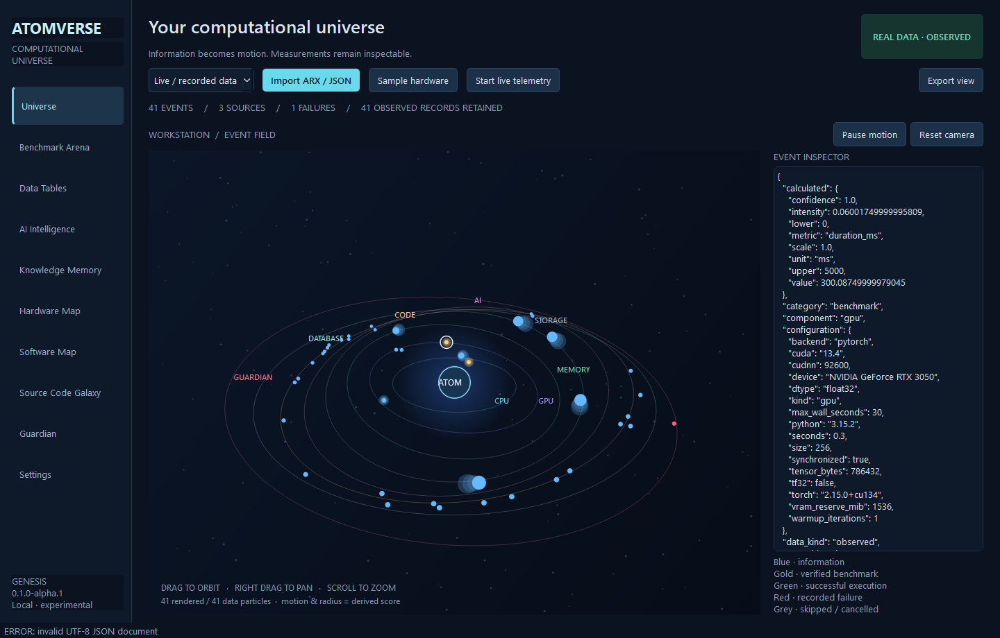

# ⚛️♾️ ATOMVERSE AI
## THE LIVING UNIVERSE OF COMPUTATIONAL INTELLIGENCE

**0.1.0-alpha.1 — working experimental Windows alpha.** The public documentation genesis was completed and remotely verified before development. A native application now demonstrates the full measured-data flow.

ATOMVERSE AI is a living computational universe that transforms real hardware telemetry, AI activity, source code, benchmarks and software events into interactive visual structures, measurable simulations and persistent knowledge.

**The computer's actual computational behavior determines the behavior of its graphical universe.**

Information absorption is inspired by atoms absorbing energy. This is a digital analogy: no physical atoms are manipulated and no physical energy is produced from information. Visual energy is a dimensionless, reproducible score.

> INFORMATION BECOMES MOTION.  
> COMPUTATION BECOMES STRUCTURE.  
> MEASUREMENTS BECOME A UNIVERSE.

### Mission contract

1. Publish this public documentation repository and verify its contents remotely.
2. Only after that verification, discover the workstation and reusable engines, select an architecture, and implement a tested Windows application.

The original human concept, engineering proposals, implemented capabilities, and future experiments are separate. A file describing a capability is not evidence that it exists.

### Explore the mission

- [Original human vision](CONCEPT/ORIGINAL-HUMAN-VISION.md)
- [Genesis architecture](GENESIS-ARCHITECTURE.md)
- [Roadmap](ROADMAP.md)
- [Acceptance criteria](SPECIFICATIONS/ACCEPTANCE-CRITERIA.md)
- [Security boundaries](ARCHITECTURE/SECURITY-BOUNDARIES.md)
- [Engineering decisions](ARCHITECTURE/ENGINEERING-DECISIONS.md)
- [License decision](LICENSE-DECISION.md)

### First usable milestone

Launch on Windows; ingest a real ARX report; validate and normalize events; create inspectable graphical objects; persist SQLite history; execute bounded CPU and supported GPU benchmarks; replay events; export JSON; report failures accurately; close cleanly. The interface should work without command-line knowledge.

**REAL DATA → EVENT → VISUAL OBJECT → MEASUREMENT → MEMORY**

Target: Windows 11 x64, PowerShell 7. Hardware and installed software must be freshly discovered. Historical hardware reports are not proof of present capabilities.

### Working now

- Interactive projected universe: rotate, pan, zoom, select, pause and adjust rendering quality.
- Explicit ARX 0.1 report import with schema checks, stable event IDs, units, hashes and field provenance.
- Requested CPU/RAM/GPU observations; continuous telemetry is opt-in.
- SQLite history, chronological replay, sortable/searchable measurements, JSON and CSV export.
- Bounded CPU float-matrix and optional CUDA/PyTorch matrix benchmarks with numerical verification, cancellation and timeout.
- Clearly isolated demo; selected text and repository metadata intake; optional loopback model API.

### Launch

On the mission workstation, open **dist/ATOMVERSE-AI/ATOMVERSE-AI.exe**. Keep its entire folder together. Alternatively run scripts/launch.ps1. A new history starts in **DEMO: SYNTHETIC DATA**; use Import ARX / JSON or Sample hardware to switch to observations.

Source/build instructions and controls: [SOFTWARE/README.md](SOFTWARE/README.md). GPU tests require a separately installed, explicitly selected PyTorch Python. No model, CUDA runtime or SQL Server is required for the standalone CPU/demo application.

### Verification and scope

**46 automated tests pass.** The actual packaged executable imported 38 events from a fresh ARX report, ran CPU and RTX 3050 CUDA benchmarks, persisted 44 observed records including hardware samples and an intentional error test, replayed events, exported/read back JSON, and exited with no surviving child processes. See [functional tests](EVIDENCE/ATOMVERSE-FUNCTIONAL-TESTS.json), [GUI verification](EVIDENCE/ATOMVERSE-GUI-VERIFICATION.json), [benchmark results](EVIDENCE/ATOMVERSE-BENCHMARK-RESULTS.json), and [build hash](EVIDENCE/BUILD-MANIFEST.json).

This is a software-painted 3D projection and an experimental engineering tool. Rich physics, the broader benchmark suite, automated regression analysis, full dependency graphs and direct COG/Codex adapters remain future work. The historical Qwen3-Coder model is unavailable at its reported paths; no real local-model inference is claimed. The unsigned build is local; no GitHub binary release has been published.

Read the [final mission report](ATOMVERSE-FINAL-REPORT.md), [implemented architecture](ATOMVERSE-ARCHITECTURE.md), [event schema](ATOMVERSE-EVENT-SCHEMA.json), [visualization specification](ATOMVERSE-VISUALIZATION-SPEC.md), and [database specification](ATOMVERSE-DATABASE-SCHEMA.md).

### Data and operator control

Only explicit data sources may be ingested. No private-session interception, keystroke capture, browser scraping, credentials, or unrelated personal content. Demo mode must display **DEMO: SYNTHETIC DATA**. Observations, calculations, AI interpretations, and simulated rendering properties remain distinct.

Public commits contain reviewed source and sanitized evidence. Raw local reports, models, databases, credentials, and workstation-specific paths belong outside version control.

### Development status

Stage 1: complete and remotely verified. Stage 2: the first packaged vertical slice is verified; expansion remains on the roadmap. See [CHANGELOG](CHANGELOG.md) and [evidence index](EVIDENCE/README.md).

Operating principle: **INGEST → CLASSIFY → MEASURE → TRANSFORM → VISUALIZE → REMEMBER → LEARN**  
Engineering principle: **DISCOVER → DESIGN → BUILD → TEST → VERIFY → IMPROVE**
